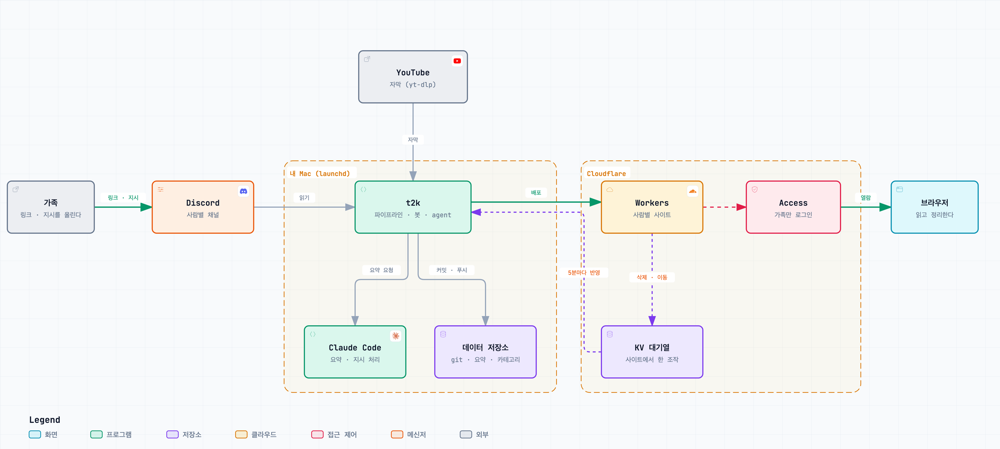

# tube-to-knowledge

[English](README.md) | 한국어

**YouTube 로 유통되는 지식을, 휘발되지 않는 나만의 아카이브로.**

오늘날 지식의 많은 부분이 YouTube 영상으로 유통된다. 그러나 영상으로 접한 지식은 보고 나면 흩어지고, 다시 찾기도 어렵다. tube-to-knowledge(`t2k`)는 가치 있는 영상을 디스코드에 보내기만 하면 자막을 바탕으로 Claude 로 요약하고 카테고리별로 분류해, 언제든 다시 찾아볼 수 있는 비공개 아카이브 사이트에 쌓는다. 매주 그 주의 지식을 다시 정리하고, 가족이 각자의 아카이브를 따로 가질 수 있다.

## 특징

- **휘발되지 않는 지식.** 모든 요약은 내 git 저장소에 파일로 남고, 나만의 비공개 사이트에 게시된다. 영상으로 배운 것이 시청 기록과 함께 사라지지 않는다.
- **들어오는 대로 정리된다.** Claude 가 카테고리를 분류하고, 맞는 카테고리가 없으면 새 카테고리를 제안한다. 카테고리별 목록과 검색을 제공하며, 사이트에서 요약을 옮기거나 삭제하고 카테고리를 추가할 수 있다.
- **나를 위한 요약.** 핵심 내용과 요점에 더해 관심사를 반영한 「개인 인사이트」, 다섯 단계의 시청 권유(「반복 필수 시청」부터 「시청 불필요」까지), 정보가 유효한 기간, 장면별 시간 표시를 제공한다. 주요 주장에는 근거의 유형(연구 인용 · 데이터 · 시연 · 의견 · 일화)을 붙이고, 근거가 약한 주장에는 「확인 필요」를 표시한다. 노래 · 공연 영상은 곡 정보로 정리한다.
- **한 주를 정리하는 주간 요약.** 매주 일요일 자정이 지나면 지난 한 주의 요약을 카테고리별로 다시 정리한다. 이번 주의 핵심, 같은 소식을 다룬 영상의 통합 요약, Shorts 묶음, 지난주 대비 변경, 관심사에 맞춘 볼 만한 영상을 한 화면에 모은다.
- **링크 하나로 끝난다.** 휴대폰 YouTube 앱의 공유 버튼으로 자기 디스코드 채널을 선택하면 된다. 1분 안에 👀 가 표시되고, 요약이 끝나면 ✅ 와 요약 주소가 답장으로 온다.
- **말로 고치는 사이트.** 「요리 영상은 재료 목록을 정리해 줘」, 「글씨를 더 크게 해 줘」처럼 디스코드에 쓰면 Claude 가 그 사람의 설정과 사이트를 고치고, 승인을 받은 뒤 반영한다.
- **가족이 함께, 따로.** 사람마다 디스코드 채널, 관심사, 카테고리, 사이트가 따로 있다. 한 대의 맥이 모든 사람의 요약을 처리한다.
- **내 컴퓨터에서, 비공개로.** 요약은 집의 맥에서 생성하고 내 git 저장소에 기록한다. 사이트는 Cloudflare Access 로 지정한 이메일만 열 수 있으며, t2k 는 잠금을 확인하기 전에는 요약을 게시하지 않는다.
- **영어 또는 한국어.** 사이트 · 요약 · 주간 요약 · 디스코드 답장의 언어를 설정 하나(`[general] language`)로 정한다.


<sub>공개 영상 여섯 편을 t2k 로 실제 요약해 생성한 화면이다 (`docs/screens/`). 썸네일과 영상의 저작권은 각 제작자에게 있다. 실제 사이트는 사람마다 로그인해야 열린다.</sub>

## 작동 방식

<picture>
  <source media="(prefers-color-scheme: dark)" srcset="docs/images/ko/flow-dark.png">
  
</picture>

링크를 올린 뒤의 과정은 모두 자동이다. 맥의 자동 실행 작업이 1분마다 디스코드 채널을 확인하고, 사람을 번갈아 가며 한 편씩 요약한다. 요약과 카테고리 변경은 데이터 저장소에 커밋되고, 바뀐 사람의 사이트만 다시 배포된다. YouTube 가 요청을 일시적으로 막으면 30분부터 최대 4시간까지 간격을 늘려 다시 시도한다. 매주 일요일 자정이 지나면 같은 작업이 지난주의 주간 요약을 카테고리마다 한 건씩 만든다. 그 주에 요약이 2편 이상인 카테고리가 대상이며, 영상 요약이 밀려 있으면 그것을 먼저 처리한다.

## 디스코드 한 줄로 사이트를 고친다

<picture>
  <source media="(prefers-color-scheme: dark)" srcset="docs/images/ko/instruct-dark.png">
  
</picture>

자기 채널에 링크 없이 글을 쓰면 **지시**가 된다. 지시는 그 채널의 owner 로 등록한 사람만 할 수 있다.

| 이렇게 쓰면 | 바뀌는 것 |
|---|---|
| 「나는 요리와 여행을 좋아해. 관심사에 넣어 줘」 | 관심사(`profile.md`). 이후 요약의 「개인 인사이트」에 반영된다 |
| 「요리 영상은 재료 목록을 따로 정리해 줘」 | 요약 방식 요청(`rules.md`) |
| 「AI 뉴스 카테고리를 만들어 줘」 | 카테고리 (이름과 분류 기준) |
| 「글씨를 더 크게 하고 배경을 어둡게 해 줘」 | 사이트 모양(`style.css` · 템플릿) |
| 「요약 몇 편이야?」 | 바꾸는 것 없이 답만 한다 |

Claude 가 수정을 마치면 바뀐 파일 목록을 답장하고 ⏳ 를 표시한다. 「승인」이라고 쓰면 반영하고 그 사람의 사이트만 다시 배포하며, 「취소」라고 쓰면 버린다. 봇의 답장에 **답장**으로 이어 쓰면 앞의 대화를 이어서 처리한다.

지시는 그 사람의 사이트 작업에만 쓰인다. Claude 는 그 사람의 파일 사본만 있는 격리된 작업 공간에서 실행되고, 셸 · 웹 도구와 홈 · 시스템 폴더 접근이 차단된다. 프로그램 코드, 다른 사람의 자료, 맥의 시스템은 지시로 바꿀 수 없다.

## 시작하기 전에

| 조건 | 이유 |
|---|---|
| **늘 켜 두는 맥** (맥 미니 등, macOS) | 1분마다 디스코드를 확인하고 요약한다. 자동 실행(launchd)과 디스코드 지시 기능은 macOS 에서만 지원한다 |
| **집 인터넷** | YouTube 는 클라우드 서버의 자막 요청을 차단하는 경우가 많다. 집 회선의 맥에서 실행하는 것을 전제로 한다 |
| **Claude 구독 또는 API** | 요약(`claude -p`, 기본 sonnet)과 지시 처리(기본 opus)에 Claude Code 를 쓴다. 요금은 각자 부담한다 |
| **디스코드 계정 · 서버** | 입력 창구다. 무료 |
| **Cloudflare 계정** | 요약 사이트(Workers)와 접근 제어(Access)에 쓴다. 개인 사용량은 무료 한도 안에 든다 |
| **터미널 사용 경험** | 명령을 붙여 넣어 실행할 수 있으면 충분하다 |

처음 설치하는 데 약 1시간이 걸린다. 각 단계 끝의 **확인**이 통과하면 다음 단계로 넘어간다. 언제든 `t2k doctor` 를 실행하면 빠진 단계를 표시한다.

> **이용 조건:** 이 프로그램은 yt-dlp 로 YouTube 자막을 받는다. 이 방식이 YouTube 이용 약관과 충돌할 수 있으므로, 본인의 책임으로 개인적인 용도로만 사용한다. 요약에는 남의 영상 내용이 담기므로 사이트는 반드시 Access 로 비공개로 둔다 (5단계). 이 프로그램은 Access 를 확인하기 전에는 요약을 올리지 않는다.

## 설치

### 1. 프로그램 설치

[Homebrew](https://brew.sh) 를 설치한 뒤 다음을 실행한다.

```sh
brew install uv yt-dlp deno node git
```

| 프로그램 | 용도 |
|---|---|
| uv | 파이썬 환경과 실행 |
| yt-dlp | 자막 · 동영상 정보. 받기가 계속 실패하면 t2k 가 새 판을 확인해 `brew upgrade yt-dlp` 를 실행한다 |
| deno | yt-dlp 가 YouTube 를 처리할 때 쓰는 JavaScript 실행기 |
| node (npx) | Cloudflare 배포 도구 wrangler 실행 (`npx wrangler@4.147.0`, 판을 고정한다) |

**Claude Code** 를 설치하고(https://claude.com/claude-code), 터미널에서 `claude` 를 한 번 실행해 로그인한다.

### 2. t2k 받기와 데이터 폴더

t2k 는 **코드**(이 저장소)와 **데이터**(요약 · 설정, 기본값 `~/t2k-data`)를 다른 폴더에 둔다. 데이터 폴더는 git 저장소로 만들어 변경 기록을 남긴다.

```sh
git clone https://github.com/aidanpark/tube-to-knowledge.git ~/tube-to-knowledge
cd ~/tube-to-knowledge
uv sync                           # 의존성 설치 (.venv)
uv run pytest -q                  # 시험. 외부 서비스는 호출하지 않는다
echo 'alias t2k="$HOME/tube-to-knowledge/.venv/bin/t2k"' >> ~/.zshrc && source ~/.zshrc
t2k init                       # ~/t2k-data 를 만든다
```

- **언어:** 데이터 폴더의 `config.toml` 에서 `[general] language = "ko"` 로 바꾼다. `t2k init` 의 기본값은 영어(`"en"`)다. 사이트 · 요약 · 주간 요약 · 디스코드 답장이 이 설정을 따른다.
- 데이터 폴더를 다른 곳에 두려면 `~/.zshrc` 에 `export T2K_HOME=폴더` 를 추가한 뒤 `t2k init` 을 실행한다.
- 데이터 폴더를 백업하려면 **비공개** 원격 저장소를 연결한다 (`git -C ~/t2k-data remote add origin …`). 원격이 있으면 t2k 가 변경할 때마다 푸시한다.
- `t2k init` 이 「커밋하지 못함」이라고 하면 git 사용자 정보를 설정한 뒤 다시 실행한다: `git config --global user.name "이름"`, `git config --global user.email "메일"`.

**확인:** `t2k doctor` 의 [프로그램] · [데이터 폴더]가, 아직 하지 않은 subdomain 과 사람 항목을 빼고 ✓ 이다.

### 3. 디스코드 봇

1. https://discord.com/developers/applications → **New Application** → 이름(예: t2k) 를 정한다.
2. 왼쪽 **Bot** 화면에서
   - **Privileged Gateway Intents → Message Content Intent 를 켜고 저장한다.** 꺼져 있으면 링크와 글의 내용이 빈 값으로 온다.
   - **Reset Token** → 새 토큰의 **Copy** 를 누른다. 토큰은 이때 한 번만 보인다.
3. 토큰을 파일에 저장한다. 아래 명령은 클립보드의 토큰을 저장하므로, **명령을 복사해 붙이지 말고 직접 입력한다** (명령을 복사하면 클립보드의 토큰이 덮어써진다).
   ```sh
   mkdir -p ~/.config/t2k
   umask 077; printf 'DISCORD_BOT_TOKEN=%s\n' "$(pbpaste)" > ~/.config/t2k/discord.env; pbcopy < /dev/null
   ```
   토큰은 비밀번호와 같다. 채팅 · 저장소에 남기지 않는다.
4. 봇을 서버에 초대한다. 서버가 없으면 디스코드 앱에서 먼저 만든다 (왼쪽 **+** → 직접 만들기).
   개발자 포털 → **OAuth2 → URL Generator** → Scopes **bot** → Bot Permissions **View Channels · Send Messages · Read Message History · Add Reactions · Embed Links** → 아래에 생성된 주소를 브라우저에서 열고 서버를 선택한다.

**확인:** `t2k doctor` 의 [디스코드]에서 봇 이름과 Message Content Intent 가 ✓ 이다.

### 4. 디스코드 채널과 ID

1. 디스코드 설정 → 고급 → **개발자 모드** 를 켠다. 이제 채널 · 사람을 우클릭하면 **ID 복사** 가 나온다.
2. 사람마다 **비공개 채널**을 하나 만든다 (예: `유튜브정리-앨리스`). 채널 만들기 → 비공개 채널 켜기 → 그 사람과 봇을 추가한다.
   두 번째 채널부터는 첫 채널을 우클릭 → **채널 복제** 로 만들면 비공개 설정과 봇 권한이 따라온다.
3. 가족을 초대한다: 서버 이름 → 초대하기. 들어온 사람을 그 사람의 채널에 추가하고, 채널 설정 → 권한 → 그 사람에게 **메시지 기록 보기 · 링크 첨부 · 반응 추가**를 허용한다 (허용하지 않으면 봇의 답장을 다시 볼 수 없다). 디스코드는 만 14세 미만은 쓸 수 없다.
4. 각 채널의 **채널 ID**, 그리고 그 채널에서 지시할 사람(본인, 관리자)의 **사용자 ID**를 복사해 둔다.

### 5. Cloudflare 와 사람 추가

#### 5-1. 로그인과 하위 도메인

```sh
npx --yes wrangler@4.147.0 login     # 브라우저에서 Cloudflare 로그인 · 허용
```

Cloudflare 대시보드 → **Workers & Pages** 를 열면 계정의 workers.dev 하위 도메인이 보인다 (처음이면 정하라고 한다). 그 값을 데이터 폴더의 `config.toml` 에 쓴다.

```toml
[site]
subdomain = "myname"     # 사이트 주소가 https://<id>-yt.myname.workers.dev 가 된다
```

> **주의:** wrangler 명령을 데이터 폴더나 `site/` 가 있는 폴더에서 직접 실행하지 않는다. 일부 wrangler 명령은 실행한 폴더의 `site/` 를 보호 없이 공개 배포한다. t2k 는 항상 빈 임시 폴더에서 wrangler 를 실행한다.

#### 5-2. 사람 추가

```sh
t2k user add --id alice --name 앨리스 --channel <채널 ID> --owner <앨리스 사용자 ID> --owner <관리자 사용자 ID>
```

- `--id` 는 영문 소문자 · 숫자다. 폴더 이름과 사이트 주소에 쓴다.
- `--owner` 는 이 채널에서 **지시**를 받을 사람이다. 링크는 채널의 누구나 올릴 수 있지만, 지시는 owner 만 할 수 있다.
- 이 명령은 사람 폴더(`users/alice/`: 카테고리 「기타」 하나, 관심사 `profile.md`)와 사이트 조작 대기열(KV)을 만들고, **「준비 중」 한 줄만 있는 사이트**를 올린다. 요약은 아직 올리지 않는다.

#### 5-3. Access 로 사이트 잠그기

1. Cloudflare 대시보드 → **Zero Trust**. 처음이면 팀 이름을 정하고 **Free** 요금제를 선택한다 (계정에 따라 결제 수단 등록을 요구할 수 있다).
2. Zero Trust → Access controls → **Policies → Add a policy**: 이름(예: 「앨리스와 관리자」), Action **Allow**, Include **Emails** 에 이 사이트를 열 사람의 이메일을 넣는다.
3. 대시보드 → Workers & Pages → `alice-yt` → **Protect this Worker behind Access** (Settings → Domains & Routes 의 workers.dev 항목에도 있다) → Scope **All traffic** → 2의 정책 선택 → 적용.

화면 이름은 Cloudflare 가 바꾸는 일이 있다 (2026-10 기준). 찾기 어려우면 대시보드 검색창에 「Access」를 입력한다.

#### 5-4. 사이트 열기

```sh
t2k user ready alice
```

사이트 주소가 Access 로그인 화면으로 넘어가는지(302) 확인한 뒤에만 `ready = true` 로 바꾸고 요약 사이트를 올린다. 확인이 실패하면 아무것도 올리지 않는다.

사람마다 5-2 ~ 5-4 를 반복한다. `t2k user list` 로 목록을 본다.

**확인:** `t2k doctor` 의 [Cloudflare]에서 각 사람의 사이트가 「302 → Access 로그인」이다. **「사이트가 Access 없이 열린다」가 나오면 즉시 Access 설정을 확인한다.**

### 6. 자동 실행

```sh
t2k service install
```

작업 세 개를 macOS launchd 에 등록한다. 맥을 다시 켜고 로그인하면 자동으로 실행된다.

| 작업 | 하는 일 | 주기 | 기록 (`~/Library/Logs/t2k/`) |
|---|---|---|---|
| `com.<사용자>.t2k.pipeline` | 링크를 읽어 요약하고 사이트를 올린다. 일요일 자정 뒤에는 주간 요약을 만든다 | 1분 | `pipeline.log` |
| `com.<사용자>.t2k.agent` | 디스코드 지시를 처리한다 | 1분 + 봇이 호출 | `agent.log` |
| `com.<사용자>.t2k.bot` | 디스코드에 상시 접속해 지시를 바로 받는다 | 상시 | `bot.log` |

상태는 `t2k service status`, 해제는 `t2k service uninstall` 이다.

**확인:** `t2k doctor` 가 「문제 없음」이다. 휴대폰 YouTube 앱에서 영상 → 공유 → 디스코드 → 자기 채널을 선택해 보낸다. 1분 안에 👀, 몇 분 뒤 ✅ 와 요약 주소가 답장으로 온다.

## 사용

- **요약 요청:** YouTube 링크를 자기 채널에 보낸다. 공유 화면에 채널이 안 보이면 공유 화면의 검색창에 채널 이름을 입력한다.
- **지시:** 링크 없이 글을 쓴다 ([디스코드 한 줄로 사이트를 고친다](#디스코드-한-줄로-사이트를-고친다)).
- **사이트 조작:** 요약 화면 아래에서 카테고리를 옮기거나 요약을 삭제하고, 카테고리 화면에서 카테고리를 추가한다. 몇 분 안에 반영된다.
- **수동 명령:** `t2k summarize <URL> --user alice`(바로 요약) · `t2k weekly 2026-W42`(그 주의 주간 요약을 만들고 배포. 비우면 지난주) · `t2k redeploy`(사이트 다시 올리기) · `t2k sync-ops`(사이트 조작 바로 반영) · `t2k discord-check`.

### 사람별 파일 (`<데이터 폴더>/users/<id>/`)

| 파일 | 내용 |
|---|---|
| `profile.md` | 관심사. 요약의 개인화 항목에 쓰인다 |
| `rules.md` | 요약 방식 요청 (예: 요리 영상은 재료 목록을 정리) |
| `categories.toml` | 카테고리 (이름 · 설명). 설명이 Claude 의 분류 기준이 된다 |
| `templates/` · `style.css` | 사이트 모양. 기본 템플릿(`t2k/site_templates/`)의 같은 이름 파일을 덮어쓰고, CSS 를 덧붙인다 |
| `summaries/` | 요약. 커밋한다 |
| `weekly/` | 주간 요약 (`<YYYY-Www>/<카테고리 id>.json`). 커밋한다 |
| `site/` · `state/` | 생성한 사이트 · 처리 상태. 커밋하지 않는다 |

설정의 기본값은 `t2k/defaults.toml` 에 있다. 바꾸려면 데이터 폴더의 `config.toml` 에 같은 표와 키를 쓴다 (예: `[summary]` 아래 `model = "haiku"`).

## 업데이트

```sh
cd ~/tube-to-knowledge && git pull && uv sync && t2k service install && t2k doctor
```

## 문제 해결

| 증상 | 확인 · 조치 |
|---|---|
| 👀 가 안 달린다 | `t2k doctor` 의 [디스코드]. `bot.log` 에 「접속」이 있는지 본다. 토큰을 다시 발급했으면 `discord.env` 를 바꾸고 `t2k service install` |
| 링크를 올렸는데 반응이 없고 로그에 내용이 비어 있다 | Message Content Intent 가 꺼져 있다 (3단계) |
| 로그에 「차단으로 쉬는 중」 | YouTube 가 집 IP 의 자막 요청을 막았다 (429). 30분 → 1시간 → 2시간 → 4시간 간격으로 다시 시도한다. 4시간 이상이면 사이트 홈에 안내가 나온다 |
| 「claude -p 오류」 | Claude Code 로그인이 풀렸거나 사용 한도에 도달했다. 터미널에서 `claude` 를 실행해 확인한다. 「claude not found in PATH」이면 `t2k service install` 을 다시 실행한다 |
| 「조작 대기열 확인 실패 … [code: 10000]」 | wrangler 로그인 갱신 직후의 일시 오류. 자동으로 다시 시도한다. 계속되면 `npx --yes wrangler@4.147.0 login` |
| 사이트 배포 실패 | `pipeline.log` 의 「사이트 배포 실패」. 다음 주기에 다시 시도한다. 수동: `t2k redeploy <id>` |
| 가족이 봇의 답장을 다시 볼 수 없다 | 그 사람에게 채널의 메시지 기록 보기 권한이 없다 (4단계) |
| 지시에 반응이 없다 | `agent.log`. 그 사람의 지시가 승인 대기(⏳)이면 「승인」 · 「취소」 뒤에 다음 지시를 처리한다 |

## 보안

- **사이트:** Cloudflare Access 로 지정한 이메일만 연다. 새 사이트는 내용 없는 안내 페이지로 만들고, Access 로그인으로 넘어가는 것을 확인한 뒤에만 요약을 올린다 (`t2k user ready`). Worker 의 조작 API(`/api/ops`)는 Access 를 거친 요청만 받는다. 검색 엔진 수집은 robots.txt · `X-Robots-Tag` · meta 로 막는다.
- **디스코드 지시:** owner 로 등록한 사람이 자기 채널에 쓴 글만 지시로 받는다. Claude 는 그 사람의 파일 사본만 있는 임시 작업 공간(`/private/tmp/t2k-agent`)에서 실행하며, 셸 · 웹 도구와 홈 · 시스템 폴더의 읽기 · 쓰기를 거부 규칙으로 막는다. 맥의 전역 Claude Code 설정과 MCP 서버도 적용하지 않는다. 결과 중 그 사람의 파일만 반영하고, 사람별 템플릿은 Jinja 샌드박스에서 렌더링한다. 적용은 「승인」 뒤에만 한다.
- **요약:** 영상의 자막 · 설명란은 신뢰하지 않는 데이터로 다룬다 (프롬프트의 보안 규칙). 관련 링크는 설명란에 실제로 있는 주소만 쓴다.
- **비밀:** 디스코드 토큰은 `~/.config/t2k/discord.env`(권한 600)에, Cloudflare 로그인 정보는 wrangler 가 보관한다. 데이터 폴더와 이 저장소에는 비밀을 두지 않는다. 자막 원문(`transcripts/`)은 커밋하지 않는다.

## 구성

<picture>
  <source media="(prefers-color-scheme: dark)" srcset="docs/images/ko/architecture-dark.png">
  
</picture>

| 모듈 | 하는 일 |
|---|---|
| `pipeline.py` | 1분 주기: 디스코드 확인 → 요약 → 주간 요약 → 사이트 조작 반영 → 커밋 · 배포 → 디스코드 답장 |
| `transcript.py` · `ytdlp_update.py` | yt-dlp 로 자막 · 동영상 정보 확보, yt-dlp 자동 업데이트 |
| `summarize.py` · `prompts/summarize.txt` | Claude 요약 (JSON 형식 검증, 음악 형식) |
| `weekly.py` · `prompts/weekly.txt` | 주간 요약 (매주 일요일 자정, 카테고리별) |
| `site.py` · `site_templates/` · `site_assets/` | 정적 사이트 생성 |
| `deploy.py` · `worker/index.js` · `site_ops.py` | Workers 배포, 사이트 조작 대기열(KV) |
| `discord_inbox.py` · `bot.py` | 디스코드 읽기 · 답장, 실시간 봇 |
| `agent.py` | 디스코드 지시 처리 (작업 공간, 승인 흐름) |
| `config.py` · `defaults.toml` | 설정과 사람별 경로 |
| `setup.py` · `service.py` · `doctor.py` | 설치 명령 · 자동 실행 등록 · 점검 |

README 의 도식은 `docs/diagrams/` 에서 생성한다. 구조 도식은 [archify](https://github.com/tt-a1i/archify) 사양(`architecture.json`)으로, 처리 흐름과 지시 흐름은 diagram-design 양식의 생성 스크립트(`build.py`)로 만든다.

## 라이선스

MIT (`LICENSE`). `transcript.py` 의 출력 규약은 smykla-skalski/sai 의 `fetch_transcript.py`(MIT)를 따른다 (`THIRD_PARTY_NOTICES.md`).
