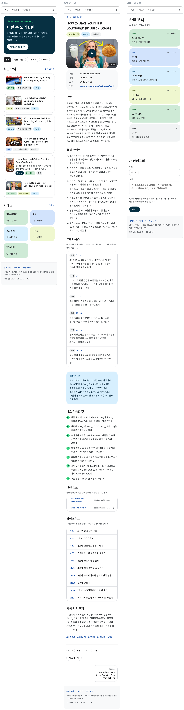
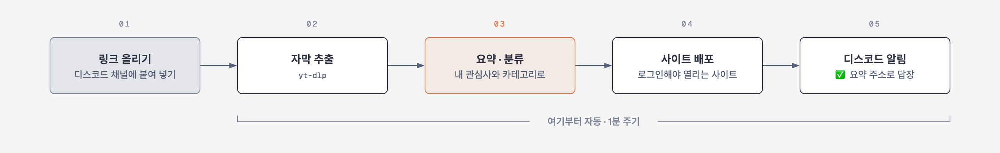
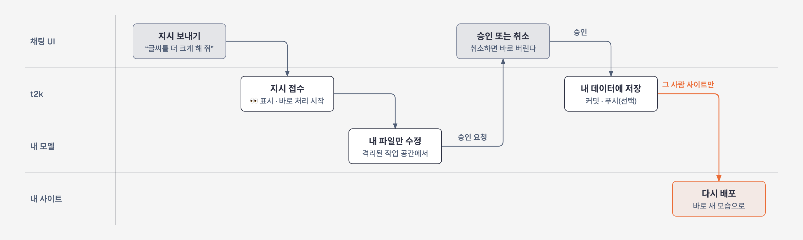

# tube-to-knowledge

[English](README.md) | 한국어

**YouTube 로 유통되는 지식을, 휘발되지 않는 나만의 아카이브로.**

오늘날 지식의 많은 부분이 YouTube 로 유통되지만, 영상으로 접한 지식은 보고 나면 흩어진다. 남겨 둘 영상을 디스코드에 공유하면, tube-to-knowledge 가 영상마다 잘 정리된 요약을 만들어 나만의 비공개 사이트에 쌓는다. 필요할 때 언제든 다시 찾아볼 수 있다.

## 시작하기

AI 코딩 에이전트에게 설치를 맡기면 된다. 맥에서 [Claude Code](https://claude.com/claude-code)를 열고 다음과 같이 요청한다.

> https://github.com/aidanpark/tube-to-knowledge 의 AGENT_INSTALL.md 를 따라 이 맥에 tube-to-knowledge 를 설치해 줘. 내 계정 · 토큰 · 브라우저 로그인이 필요한 단계에서는 멈추고 나에게 요청해.

에이전트가 설치를 진행하다가, 사람이 해야 하는 단계에서 멈추고 요청한다. 디스코드 봇 만들기, Cloudflare 로그인, 사이트 잠금이 그런 단계다. 에이전트는 비밀번호와 토큰을 다루지 않는다. 한국어로 쓰려면 처음에 언어를 한국어로 하겠다고 말하면 된다.

**다른 컴퓨터 · AI · 메신저를 쓴다면:** 요청에 자기 환경을 덧붙이고, 그 부분을 환경에 맞게 포팅해 달라고 하면 된다. tube-to-knowledge 가 지원하는 구성은 macOS · Claude Code · 디스코드 · Cloudflare 이고, 그 밖의 구성은 사용자가 직접 하는 커스텀이므로 에이전트가 무엇을 바꾸는지 확인한다. 예:

> https://github.com/aidanpark/tube-to-knowledge 의 AGENT_INSTALL.md 를 따라 이 **Windows PC** 에 tube-to-knowledge 를 설치해 줘. 안내는 macOS 기준이니 Windows 에 맞게 바꿔 줘: launchd 대신 작업 스케줄러, macOS 경로 대신 Windows 경로. 안내의 안전 규칙은 그대로 지켜 줘: 내 토큰을 다루지 않기, Access 확인 전에는 사이트를 게시하지 않기, 디스코드 지시는 격리된 공간에서만 처리하기. 내 계정 · 토큰 · 브라우저 로그인이 필요한 단계에서는 멈추고 나에게 요청해.

> 나는 Claude Code 대신 **Codex** 를 쓴다. https://github.com/aidanpark/tube-to-knowledge 의 AGENT_INSTALL.md 를 따라 이 맥에 tube-to-knowledge 를 설치해 줘. t2k 는 summarize.py · weekly.py · agent.py · doctor.py 에서 Claude Code CLI(`claude -p`)를 호출하니, 이 호출을 Codex 의 비대화형 실행으로 포팅해 줘. 디스코드 지시 처리(agent.py)를 포팅할 때는 같은 제한을 걸어 줘: 셸 · 웹 도구 없이, 그 사람의 파일에만 접근하게. 안내의 다른 안전 규칙도 그대로 지키고, 내 계정 · 토큰 · 브라우저 로그인이 필요한 단계에서는 멈추고 나에게 요청해.

직접 설치하려면 [안내서](docs/guide.ko.md#설치)를 따른다.

## 특징

- **휘발되지 않는 지식.** 공유한 영상은 모두 다시 찾을 수 있는 요약으로 남는다. 시청 기록이 밀려나도 배운 것은 남는다.
- **공유 한 번으로 저장.** YouTube 앱에서 내 디스코드 채널로 공유하면, 몇 분 뒤 요약 주소가 답장으로 온다.
- **나를 위한 요약.** 핵심 내용, 내 관심사에 주는 의미, 원본을 볼 가치가 있는지, 정보가 얼마나 오래 유효한지, 다시 확인할 주장이 무엇인지 알려 준다.
- **들어오는 대로 정리.** 영상은 내 카테고리로 자동 분류되고, 사이트에서 둘러보고 검색할 수 있다.
- **한 주를 정리하는 주간 요약.** 매주 일요일 밤, 그 주의 영상을 주제별로 다시 정리한다. 핵심, 여러 영상이 함께 다룬 소식, 원본까지 볼 만한 영상을 한 화면에 모은다.
- **말로 고치는 사이트.** 요약 방식이나 사이트 모양을 디스코드에 말로 요청하고, 승인하면 바뀐다.
- **가족이 함께, 따로.** 사람마다 자기 채널, 관심사, 비공개 사이트를 가진다.
- **영어 또는 한국어.** 사이트 · 요약 · 답장의 언어를 고를 수 있다.

공개 영상 여섯 편의 실제 출력이다. 썸네일과 영상의 저작권은 각 제작자에게 있다.

## 작동 방식

<picture>
  <source media="(prefers-color-scheme: dark)" srcset="docs/images/ko/flow-dark.png">
  
</picture>

링크를 공유하는 것 외에는 모두 자동이다. 맥이 자막을 읽고, AI 가 요약하고 분류하고, 사이트가 갱신되고, 디스코드로 완료를 알린다.

## 말로 고치는 사이트

<picture>
  <source media="(prefers-color-scheme: dark)" srcset="docs/images/ko/instruct-dark.png">
  
</picture>

내 채널에 링크 없이 글을 쓰면 된다. 예:

- 「나는 요리와 여행을 좋아해. 관심사에 넣어 줘」
- 「요리 영상은 재료 목록을 따로 정리해 줘」
- 「글씨를 더 크게 하고 배경을 어둡게 해 줘」

무엇이 바뀌는지 보고 「승인」 또는 「취소」로 답한다. 바뀌는 것은 언제나 내 사이트뿐이다.

## 필요한 것

이 프로젝트가 지원하는 구성은 다음과 같다.

- 집 인터넷에 연결해 늘 켜 두는 맥
- 요약을 작성하는 AI 를 위한 Claude 구독
- 디스코드 계정과 서버 (무료)
- Cloudflare 계정 (개인 사용은 무료)

**각 요소는 원하는 것으로 교체할 수 있다.** tube-to-knowledge 가 제공하는 핵심 가치는 영상의 지식을 수집하고 정리하는 파이프라인이다. 그 주변의 요소는 사용자가 선택한다. 맥 대신 Windows PC 나 Linux 서버를, Claude 대신 다른 AI 를, 디스코드 대신 텔레그램이나 슬랙을, Cloudflare 대신 다른 호스팅을 쓸 수 있다. 다만 이 프로젝트가 지원하는 것은 위의 구성뿐이므로, 요소를 교체하는 것은 사용자가 직접 하는 커스텀이다. 포팅은 AI 코딩 에이전트에게 맡길 수 있다 ([시작하기](#시작하기)의 예).

## 개인 정보 보호

- 요약은 내 맥에서 만들어지고, 내 git 저장소에 보관된다.
- 사이트는 내가 지정한 이메일로만 열리며, 이 잠금이 확인되기 전에는 아무것도 게시하지 않는다.
- 디스코드 요청은 그 사람의 사이트만 바꿀 수 있고, 컴퓨터는 건드리지 못한다.

tube-to-knowledge 는 yt-dlp 로 YouTube 자막을 읽는다. 이 방식이 YouTube 이용 약관과 충돌할 수 있으므로 개인적인 용도로만 쓰고, 사이트는 비공개로 둔다.

## 더 알아보기

- [안내서](docs/guide.ko.md): 직접 설치, 사용법, 문제 해결, 보안, 구성
- [AGENT_INSTALL.md](AGENT_INSTALL.md)(영문): AI 에이전트가 따르는 단계별 설치 안내

## 라이선스

MIT ([LICENSE](LICENSE)). 제3자 고지는 [THIRD_PARTY_NOTICES.md](THIRD_PARTY_NOTICES.md) 를 본다.
