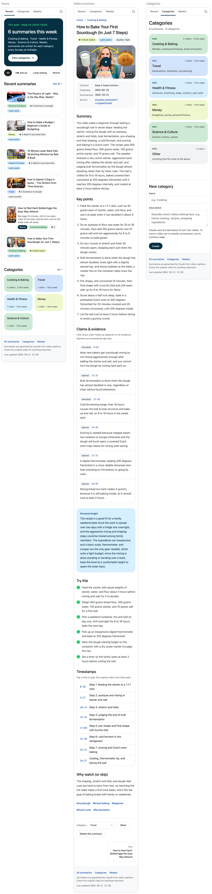

# tube-to-knowledge

English | [한국어](README.ko.md)

**Turn the knowledge flowing through YouTube into an archive that lasts.**

So much of what we learn today comes from YouTube, and most of it fades once the video ends. Share the videos worth keeping to Discord, and tube-to-knowledge turns each one into a clear, organized summary on your own private site, ready whenever you want it again.

## Get started

Ask an AI coding agent to set it up. On a Mac with [Claude Code](https://claude.com/claude-code), say:

> Set up tube-to-knowledge on this Mac by following AGENT_INSTALL.md in https://github.com/aidanpark/tube-to-knowledge. Stop and ask me whenever a step needs my account, a token or a browser login.

The agent does the setup and stops when it needs you: to create a Discord bot, sign in to Cloudflare, and lock your site. It never handles your passwords or tokens.

**Using a different computer, AI or messenger?** Add your setup to the request and ask the agent to port those parts. tube-to-knowledge supports macOS, Claude Code, Discord and Cloudflare; any other setup is your own customization, so review what the agent changes. For example:

> Set up tube-to-knowledge on this **Windows PC** by following AGENT_INSTALL.md in https://github.com/aidanpark/tube-to-knowledge. The guide is written for macOS, so adapt it to Windows: use Task Scheduler instead of launchd and Windows paths instead of macOS ones. Keep its safety rules: never handle my tokens, never publish a site before Access is confirmed, and keep Discord requests sandboxed. Stop and ask me whenever a step needs my account, a token or a browser login.

> I use **Codex** instead of Claude Code. Set up tube-to-knowledge on this Mac by following AGENT_INSTALL.md in https://github.com/aidanpark/tube-to-knowledge. t2k calls the Claude Code CLI (`claude -p`) in summarize.py, weekly.py, agent.py and doctor.py; port those calls to Codex's non-interactive mode. For Discord requests (agent.py), give the ported agent the same restrictions: no shell or web tools, and access to that person's files only. Keep the guide's other safety rules, and stop and ask me whenever a step needs my account, a token or a browser login.

Prefer to do it yourself? Follow the [guide](docs/guide.md#install).

## Features

- **Knowledge that stays.** Every video you share becomes a summary you can find again, long after your watch history has moved on.
- **One tap to save.** Share from the YouTube app to your Discord channel. A few minutes later, a reply brings the link to your summary.
- **Summaries written for you.** The key ideas, what it means for your interests, whether the full video is worth your time, how long the information stays useful, and which claims need a second look.
- **Organized as it arrives.** Videos are filed into your categories automatically, and the site makes everything easy to browse and search.
- **A weekly review.** Every Sunday night, the week's videos are distilled by topic: the main takeaways, stories covered by several videos, and the few worth watching in full.
- **Change it by asking.** Tell it in Discord how you want summaries written or how your site should look, and approve the change.
- **For the whole family.** Everyone gets their own channel, interests and private site.
- **English or Korean.** Choose the language of your site, summaries and replies.

Real output for six public videos. Thumbnails and videos belong to their creators.

## How it works

<picture>
  <source media="(prefers-color-scheme: dark)" srcset="docs/images/en/flow-dark.png">
  
</picture>

You share a link. Everything after that happens on its own: your Mac reads the captions, AI writes the summary and files it, your site is updated, and Discord tells you it is ready.

## Change your site by asking

<picture>
  <source media="(prefers-color-scheme: dark)" srcset="docs/images/en/instruct-dark.png">
  
</picture>

Write a message without a link in your channel, for example:

- "I love cooking and travel. Add that to my interests."
- "For cooking videos, list the ingredients separately."
- "Make the text bigger and the background darker."

You see what will change and reply "approve" or "cancel". Only your own site is ever touched.

## What you need

The supported setup:

- A Mac that stays on, on your home internet
- A Claude subscription, for the AI that writes the summaries
- A Discord account and server, free
- A Cloudflare account, free for personal use

**Swap any part you like.** What tube-to-knowledge offers is the pipeline that collects knowledge from videos and organizes it. The parts around that pipeline are your choice: a Windows PC or Linux server instead of a Mac, another AI instead of Claude, Telegram or Slack instead of Discord, another host instead of Cloudflare. The project supports only the setup above, so a swap is a customization you make yourself. An AI coding agent can do the porting, as in the examples under [Get started](#get-started).

## Private by design

- Your summaries are created on your own Mac and kept in your own git repository.
- Each site opens only for the email addresses you choose, and nothing is published until that lock is confirmed.
- Requests from Discord can change only that person's site, never your computer.

tube-to-knowledge reads YouTube captions with yt-dlp, which may conflict with YouTube's Terms of Service. Use it for personal purposes and keep your sites private.

## Learn more

- [Guide](docs/guide.md): manual installation, everyday use, troubleshooting, security and architecture
- [AGENT_INSTALL.md](AGENT_INSTALL.md): the step-by-step instructions your AI agent follows

## License

MIT ([LICENSE](LICENSE)). See [THIRD_PARTY_NOTICES.md](THIRD_PARTY_NOTICES.md) for third-party notices.
