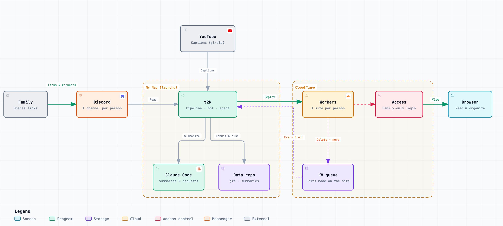
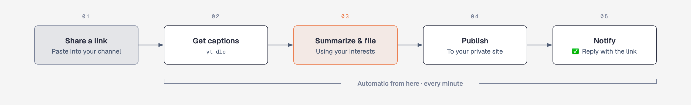
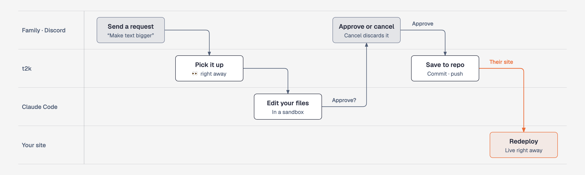

# tube-to-knowledge

English | [한국어](README.ko.md)

**Turn the knowledge flowing through YouTube into an archive that lasts.**

A growing share of what we learn now comes from YouTube. But knowledge picked up from a video fades once the video ends, and it is hard to find again. tube-to-knowledge (`t2k`) keeps the videos worth keeping: share a link to Discord, and it summarizes the video from its captions with Claude, files it into your categories, and adds it to a private, searchable archive site. Every week it distills what you collected, and each family member gets an archive of their own.

<picture>
  <source media="(prefers-color-scheme: dark)" srcset="docs/images/en/architecture-dark.png">
  
</picture>

## Features

- **Knowledge that stays.** Every summary is saved as a file in your own git repository and published to your private site. What you learned from a video does not disappear with your watch history.
- **Organized as it arrives.** Claude files each video into one of your categories and proposes a new category when nothing fits. The site offers category lists and search, and you can move or delete summaries and add categories right on the site.
- **A weekly review.** Every Sunday at midnight, t2k revisits the past week category by category: the key takeaways, one combined summary for videos covering the same news, grouped Shorts, what changed since last week, and the videos worth watching in full.
- **Summaries written for you.** Besides the summary and key points, each video gets a personal insight based on your interests, a five-level watch recommendation (from "must rewatch" to "skip"), how long the information stays valid, and timestamps. Each claim is tagged with its kind of evidence (research, data, demo, opinion, anecdote), and weakly supported claims are flagged. Music videos are filed as song information.
- **One link is all it takes.** Use the share button in the YouTube app and pick your Discord channel. 👀 appears within a minute, and ✅ with the summary link follows when it is done.
- **Change your site by asking.** Write "For cooking videos, list the ingredients" or "Make the text bigger" in Discord. Claude edits your settings and site, and applies the change after you approve it.
- **Together, but separate.** Each family member has their own channel, interests, categories and site. One Mac handles everyone.
- **On your own computer, private by default.** Summaries are generated on your Mac and recorded in your git repository. Each site opens only for the emails you allow with Cloudflare Access, and t2k publishes nothing until it has confirmed that lock.
- **English or Korean.** The site, summaries, weekly reviews and Discord replies follow one setting (`[general] language`).


<sub>Real t2k output for six public videos (`docs/screens/`). Thumbnails and videos belong to their creators. Real sites require each person to sign in.</sub>

## How it works

<picture>
  <source media="(prefers-color-scheme: dark)" srcset="docs/images/en/flow-dark.png">
  
</picture>

Everything after you share the link is automatic. A background job on your Mac checks the Discord channels every minute and summarizes one video at a time, taking turns between people. Summaries and category changes are committed to your data repository, and only the sites that changed are redeployed. If YouTube temporarily blocks caption requests, t2k waits and retries, from 30 minutes up to 4 hours. After Sunday midnight, the same job writes last week's weekly review, one category at a time, for every category with at least two summaries that week; new videos always come first.

## Change your site with one Discord message

<picture>
  <source media="(prefers-color-scheme: dark)" srcset="docs/images/en/instruct-dark.png">
  
</picture>

A message without a link in your own channel is a **request**. Only the channel's owners can make requests.

| Write this | What changes |
|---|---|
| "I love cooking and travel. Add that to my interests." | Your interests (`profile.md`), used for each summary's personal insight |
| "For cooking videos, list the ingredients separately." | How summaries are written (`rules.md`) |
| "Create a category for AI news." | Your categories (name and filing rule) |
| "Make the text bigger and the background darker." | Your site's look (`style.css`, templates) |
| "How many summaries do I have?" | Nothing; you just get an answer |

When Claude is done, it replies with the list of changed files and marks the request ⏳. Reply "approve" to apply it and redeploy your site, or "cancel" to discard it. Reply to the bot's message to continue the conversation.

Requests only ever touch that person's site. Claude runs in a sandbox that contains a copy of that person's files only, with shell and web tools and access to your home and system folders blocked. Requests cannot change the program, other people's data, or your Mac.

## Before you start

| You need | Why |
|---|---|
| **A Mac that stays on** (Mac mini or similar, macOS) | It checks Discord and summarizes every minute. Background jobs (launchd) and Discord requests are macOS-only |
| **A home internet connection** | YouTube often blocks caption requests from cloud servers. t2k assumes a Mac on a home connection |
| **A Claude subscription or API access** | Summaries (`claude -p`, sonnet by default) and requests (opus by default) run on Claude Code. You pay for your own usage |
| **A Discord account and server** | Your inbox. Free |
| **A Cloudflare account** | The archive sites (Workers) and access control (Access). Personal use fits in the free tier |
| **Basic terminal skills** | Enough to paste and run commands |

The first setup takes about an hour. Each step ends with a **Check**; move on when it passes. Run `t2k doctor` at any time to see what is missing.

> **Note:** command-line and log messages (`t2k doctor`, `t2k user add`, the files in `~/Library/Logs/t2k/`) are currently in Korean. The site, summaries, weekly reviews and Discord replies follow `[general] language`.

> **Terms of use:** t2k fetches YouTube captions with yt-dlp. This may conflict with YouTube's Terms of Service, so use it for personal purposes and at your own risk. Summaries contain other people's content, so keep every site private with Access (step 5). t2k publishes no summaries until Access is confirmed.

## Install

### 1. Install the tools

Install [Homebrew](https://brew.sh), then run:

```sh
brew install uv yt-dlp deno node git
```

| Tool | Used for |
|---|---|
| uv | Python environment and runs |
| yt-dlp | Captions and video information. If fetching keeps failing, t2k checks for a new release and runs `brew upgrade yt-dlp` |
| deno | The JavaScript runtime yt-dlp uses for YouTube |
| node (npx) | Runs wrangler, Cloudflare's deploy tool (`npx wrangler@4.147.0`, pinned) |

Install **Claude Code** (https://claude.com/claude-code) and run `claude` once in a terminal to sign in.

### 2. Get t2k and create your data folder

t2k keeps the **code** (this repository) and your **data** (summaries and settings, `~/t2k-data` by default) in separate folders. The data folder is a git repository, so every change is recorded.

```sh
git clone https://github.com/aidanpark/tube-to-knowledge.git ~/tube-to-knowledge
cd ~/tube-to-knowledge
uv sync                           # install dependencies (.venv)
uv run pytest -q                  # tests; no external services are called
echo 'alias t2k="$HOME/tube-to-knowledge/.venv/bin/t2k"' >> ~/.zshrc && source ~/.zshrc
t2k init                          # creates ~/t2k-data
```

- To keep your data elsewhere, add `export T2K_HOME=<folder>` to `~/.zshrc` before running `t2k init`.
- The language is set in the data folder's `config.toml` (`[general] language = "en"`). Use `"ko"` for Korean.
- To back up your data, connect a **private** remote repository (`git -C ~/t2k-data remote add origin …`). With a remote, t2k pushes after every change.
- If `t2k init` reports that it could not commit, set your git identity and run it again: `git config --global user.name "Name"`, `git config --global user.email "you@example.com"`.

**Check:** in `t2k doctor`, the program and data folder sections pass, except for the subdomain and people you have not added yet.

### 3. Create the Discord bot

1. Go to https://discord.com/developers/applications → **New Application** and give it a name (for example, t2k).
2. On the **Bot** page:
   - Turn on **Privileged Gateway Intents → Message Content Intent** and save. Without it, links and messages arrive empty.
   - Click **Reset Token**, then **Copy** the new token. It is shown only once.
3. Save the token to a file. The command below saves the token from your clipboard, so **type it in rather than pasting it** (copying the command would replace the token on your clipboard).
   ```sh
   mkdir -p ~/.config/t2k
   umask 077; printf 'DISCORD_BOT_TOKEN=%s\n' "$(pbpaste)" > ~/.config/t2k/discord.env; pbcopy < /dev/null
   ```
   Treat the token like a password. Never put it in a chat or a repository.
4. Invite the bot to your server. If you do not have one, create it in the Discord app first (**+** on the left → Create My Own).
   In the developer portal, open **OAuth2 → URL Generator**, select the scope **bot** and the permissions **View Channels · Send Messages · Read Message History · Add Reactions · Embed Links**, then open the generated URL in a browser and choose your server.

**Check:** in `t2k doctor`, the Discord section shows the bot's name and Message Content Intent passes.

### 4. Discord channels and IDs

1. In Discord, open Settings → Advanced and turn on **Developer Mode**. Right-clicking a channel or person now shows **Copy ID**.
2. Create one **private channel** per person (for example, `archive-alice`): Create Channel → turn on Private Channel → add that person and the bot.
   From the second channel on, right-click the first one and choose **Duplicate Channel** to keep the private setting and bot permissions.
3. Invite your family: server name → Invite People. Add each person to their channel and, under the channel's permissions, allow **Read Message History · Attach Links · Add Reactions** (without them, they cannot see the bot's replies later). Check Discord's minimum age for your country.
4. Copy each channel's **Channel ID**, and the **User ID** of everyone who may make requests in it (the person and the administrator).

### 5. Cloudflare and people

#### 5-1. Sign in and find your subdomain

```sh
npx --yes wrangler@4.147.0 login     # sign in to Cloudflare in the browser and allow access
```

Open the Cloudflare dashboard → **Workers & Pages** to see your account's workers.dev subdomain (you will be asked to choose one the first time). Put it in your data folder's `config.toml`:

```toml
[site]
subdomain = "myname"     # sites live at https://<id>-yt.myname.workers.dev
```

> **Warning:** never run wrangler commands directly in your data folder or in any folder that contains `site/`. Some wrangler commands publish the current folder's `site/` without protection. t2k always runs wrangler from an empty temporary folder.

#### 5-2. Add a person

```sh
t2k user add --id alice --name Alice --channel <channel ID> --owner <Alice's user ID> --owner <your user ID>
```

- `--id` uses lowercase letters and digits. It becomes the folder name and part of the site address.
- `--owner` is someone who may make **requests** in this channel. Anyone in the channel can share links, but only owners can make requests.
- This creates the person's folder (`users/alice/`: one category, "Other", and an interests file `profile.md`) and the site's edit queue (KV), and deploys **a site with a single "coming soon" line**. No summaries are published yet.

#### 5-3. Lock the site with Access

1. In the Cloudflare dashboard, open **Zero Trust**. The first time, choose a team name and the **Free** plan (some accounts are asked for a payment method).
2. Zero Trust → Access controls → **Policies → Add a policy**: a name (for example, "Alice and admin"), Action **Allow**, and under Include **Emails**, the addresses that may open this site.
3. Dashboard → Workers & Pages → `alice-yt` → **Protect this Worker behind Access** (also under Settings → Domains & Routes, on the workers.dev entry) → Scope **All traffic** → choose the policy from step 2 → apply.

Cloudflare renames screens from time to time (as of October 2026). If you cannot find them, search the dashboard for "Access".

#### 5-4. Open the site

```sh
t2k user ready alice
```

t2k first checks that the site redirects to the Access sign-in page (302). Only then does it set `ready = true` and publish the archive. If the check fails, nothing is published.

Repeat 5-2 to 5-4 for each person. `t2k user list` shows everyone.

**Check:** in `t2k doctor`, the Cloudflare section shows a 302 to the Access login for every site. **If it reports that a site opens without Access, fix the Access setup immediately.**

### 6. Run in the background

```sh
t2k service install
```

This registers three macOS launchd jobs. They start automatically when you sign in after a restart.

| Job | What it does | Runs | Log (`~/Library/Logs/t2k/`) |
|---|---|---|---|
| `com.<user>.t2k.pipeline` | Reads links, summarizes, publishes; writes weekly reviews after Sunday midnight | Every minute | `pipeline.log` |
| `com.<user>.t2k.agent` | Handles Discord requests | Every minute, and when the bot wakes it | `agent.log` |
| `com.<user>.t2k.bot` | Stays connected to Discord to receive requests instantly | Always | `bot.log` |

Use `t2k service status` to check them and `t2k service uninstall` to remove them.

**Check:** `t2k doctor` reports no problems. In the YouTube app, open a video → Share → Discord → your channel. 👀 appears within a minute, and ✅ with the summary link a few minutes later.

## Usage

- **Save a video:** send a YouTube link to your channel. If your channel does not appear in the share sheet, search for its name there.
- **Make a request:** write a message without a link ([Change your site with one Discord message](#change-your-site-with-one-discord-message)).
- **Edit on the site:** move or delete a summary at the bottom of its page, and add categories on the Categories page. Changes apply within a few minutes.
- **Manual commands:** `t2k summarize <URL> --user alice` (summarize now), `t2k weekly 2026-W42` (write and publish that week's reviews; defaults to last week), `t2k redeploy` (republish sites), `t2k sync-ops` (apply site edits now), `t2k discord-check`.

### Per-person files (`<data folder>/users/<id>/`)

| File | Contents |
|---|---|
| `profile.md` | Interests, used for personal insights and picks |
| `rules.md` | How you want summaries written (for example, list ingredients for cooking videos) |
| `categories.toml` | Categories (name and description). The description is Claude's filing rule |
| `templates/` · `style.css` | The site's look. Files here override the default templates (`t2k/site_templates/`) with the same name; the CSS is appended |
| `summaries/` | Summaries. Committed |
| `weekly/` | Weekly reviews (`<YYYY-Www>/<category id>.json`). Committed |
| `site/` · `state/` | The generated site and processing state. Not committed |

Default settings live in `t2k/defaults.toml`. To change one, set the same table and key in your data folder's `config.toml` (for example, `model = "haiku"` under `[summary]`). `[summary] languages` sets the caption language priority; when empty it follows `[general] language`.

## Update

```sh
cd ~/tube-to-knowledge && git pull && uv sync && t2k service install && t2k doctor
```

## Troubleshooting

| Symptom | Check / fix |
|---|---|
| No 👀 | The Discord section of `t2k doctor`, and whether `bot.log` shows a connection. If you reset the token, update `discord.env` and run `t2k service install` |
| Links get no reaction and the log shows empty messages | Message Content Intent is off (step 3) |
| The log says t2k is pausing because of a block | YouTube is blocking caption requests from your home IP (429). t2k retries after 30 minutes, 1, 2 and 4 hours. After 4 hours, the site's home page shows a notice |
| A `claude -p` error | Claude Code is signed out or you hit a usage limit. Run `claude` in a terminal. If it says `claude not found in PATH`, run `t2k service install` again |
| An edit-queue error with `[code: 10000]` | A temporary error right after the wrangler sign-in refreshes. t2k retries. If it persists, run `npx --yes wrangler@4.147.0 login` |
| Site deploy fails | Look for the deploy failure in `pipeline.log`. t2k retries on the next run. Manually: `t2k redeploy <id>` |
| A family member cannot see the bot's earlier replies | They lack Read Message History in their channel (step 4) |
| A request gets no response | Check `agent.log`. If one of that person's requests is waiting for approval (⏳), the next one waits until they approve or cancel |

## Security

- **Sites:** only the emails you allow in Cloudflare Access can open a site. A new site starts as an empty placeholder, and summaries are published only after t2k confirms the redirect to the Access sign-in (`t2k user ready`). The Worker's edit API (`/api/ops`) accepts only requests that passed Access. Search engines are kept out with robots.txt, `X-Robots-Tag` and a meta tag.
- **Discord requests:** only messages from registered owners in their own channel count as requests. Claude runs in a temporary workspace (`/private/tmp/t2k-agent`) holding a copy of that person's files only, with shell and web tools and reads/writes to your home and system folders denied. Your global Claude Code settings and MCP servers are not loaded. Only that person's files are taken from the result, per-person templates render in a Jinja sandbox, and nothing is applied before approval.
- **Summaries:** captions and video descriptions are treated as untrusted data (security rules in the prompt). Related links are limited to URLs that actually appear in the description.
- **Secrets:** the Discord token lives in `~/.config/t2k/discord.env` (mode 600) and the Cloudflare sign-in is kept by wrangler. Neither the data folder nor this repository holds secrets. Raw captions (`transcripts/`) are never committed.

## Project layout

| Module | What it does |
|---|---|
| `pipeline.py` | The one-minute cycle: check Discord → summarize → weekly review → apply site edits → commit and deploy → reply in Discord |
| `transcript.py` · `ytdlp_update.py` | Captions and video information via yt-dlp; yt-dlp auto-update |
| `summarize.py` · `prompts/<lang>/summarize.txt` | Claude summaries (JSON validation, music format) |
| `weekly.py` · `prompts/<lang>/weekly.txt` | Weekly reviews (Sunday midnight, per category) |
| `site.py` · `site_templates/` · `site_assets/` | Static site generation |
| `deploy.py` · `worker/index.js` · `site_ops.py` | Workers deploys and the site edit queue (KV) |
| `discord_inbox.py` · `bot.py` | Reading and replying in Discord; the always-on bot |
| `agent.py` | Discord requests (sandbox, approval flow) |
| `i18n.py` · `locales/<lang>/` | Display language |
| `config.py` · `defaults.toml` | Settings and per-person paths |
| `setup.py` · `service.py` · `doctor.py` | Setup commands, background jobs, checks |

The diagrams in this README are generated in `docs/diagrams/`: the architecture diagram from an [archify](https://github.com/tt-a1i/archify) spec (`architecture-<lang>.json`), and the two flow diagrams by a diagram-design style script (`build.py`).

## License

MIT (`LICENSE`). The output contract of `transcript.py` follows `fetch_transcript.py` from smykla-skalski/sai (MIT) (`THIRD_PARTY_NOTICES.md`).
